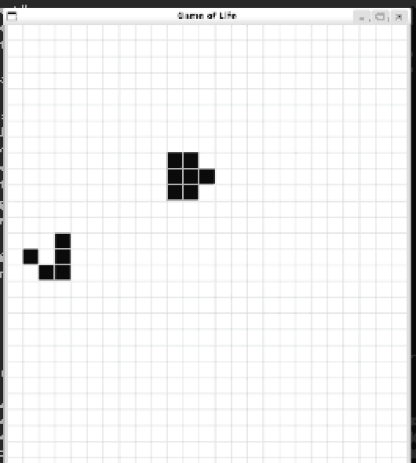
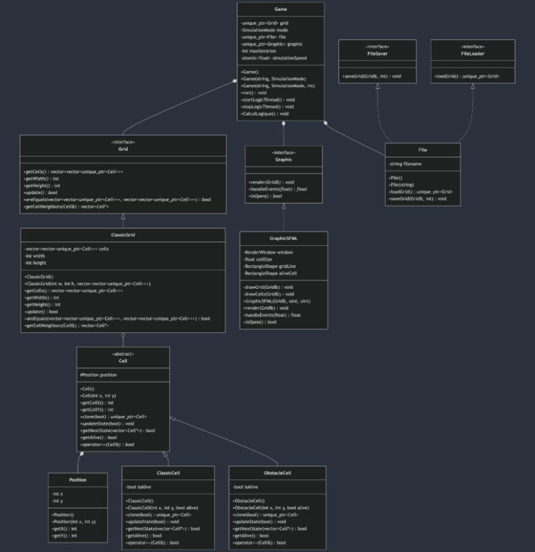

# Conway's Game of Life in C++

Object-oriented implementation of Conway's Game of Life in C++17, with a console mode that saves every
generation to text files and a graphical mode built on SFML.

Team project at CESI École d'Ingénieurs (object-oriented programming, November–December 2024).



## Features

- **Console mode**: runs up to N generations, writes each one to `<input>_out/`, and stops early as soon as the
  grid is stable.
- **Graphical mode**: live SFML window, multi-threaded; Up / Down arrows change the speed, Escape quits.
- **Obstacle cells**: cells whose state never changes (alive or dead), alongside classic cells.
- Initial grids loaded from plain text files.

## Design

Abstract interfaces and polymorphism keep each part replaceable:

| Interface | Implementation | Role |
|---|---|---|
| `Cell` | `ClassicCell`, `ObstacleCell` | cell state and transition rule |
| `Grid` | `ClassicGrid` | neighbourhood, update, stability check |
| `FileLoader`, `FileSaver` | `File` | read the initial grid, save each generation |
| `Graphic` | `GraphicSFML` | rendering and keyboard events |

`Game` ties them together and runs the chosen mode; the graphical mode updates the grid in a separate logic
thread whose speed is shared through an atomic value.



Other UML diagrams: [use cases](docs/uml/use_case_diagram.png), [sequence](docs/uml/sequence_diagram.png),
[activity](docs/uml/activity_diagram.png).

## Build and run

Linux with clang and SFML 2 (on Ubuntu: `sudo apt install clang make libsfml-dev`):

```bash
make
./game test.txt 0 50    # console mode, up to 50 generations, written to test_out/
./game test.txt 1       # graphical mode
```

## Input format

First line: `height width`. Then one line per row, values separated by spaces:

| Value | Cell |
|---|---|
| `0` / `1` | dead / alive |
| `2` / `3` | alive / dead obstacle (never changes) |

[`test.txt`](test.txt) and [`test2.txt`](test2.txt) are sample grids.

## Team

[Estebge](https://github.com/Estebge), [sashidori](https://github.com/sashidori),
[Tuture57](https://github.com/Tuture57). License: GPL-3.0.
